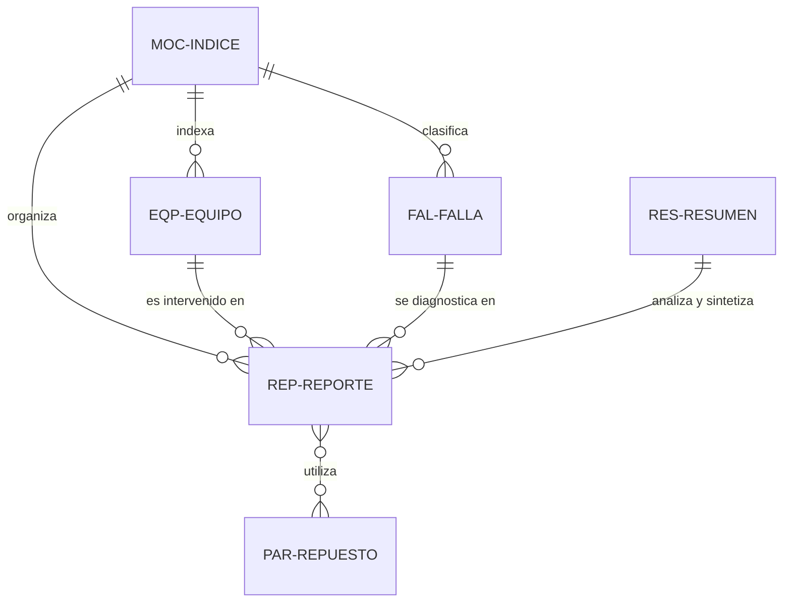

# Esquema General de la Wiki Técnica (MATRIX)

---
version: 1.0.0
fecha: 2026-11-20
estado: aprobado
autor: Arquitecto de Información y Base de Conocimiento
proyecto: MATRIX — GO Service LATAM
compatibilidad: Obsidian (v1.5+), CommonMark, RAG (Claude 3.5 Sonnet, DeepSeek V3)
---

## 1. Visión y Objetivos de la Arquitectura de Información

La base de conocimiento **MATRIX** transforma exportaciones de reportes de servicio técnico previamente limpiadas y anonimizadas en una red estructurada de conocimiento en Markdown.

Los objetivos fundamentales de este diseño son:
1. **Navegabilidad Humana Dual**: Permitir a técnicos, supervisores y coordinadores navegar visualmente mediante el grafo de Obsidian, explorando conexiones entre modelos de equipos, síntomas recurrentes y soluciones aplicadas.
2. **Optimización para Ingesta y RAG (Retrieval-Augmented Generation)**: Facilitar la fragmentación (*chunking* semántico), el emparejamiento denso/disperso (*dense & sparse retrieval*) y la generación contextual precisa mediante LLMs (Claude, DeepSeek, Gemini).
3. **Trazabilidad Forense y Auditoría Antialucinación**: Cada afirmación técnica, procedimiento o parte recomendada debe rastrearse inequívocamente hasta el reporte fuente `R-XXXXXX.md` original, eliminando conjeturas o datos no verificables.
4. **Privacidad Estricta**: No almacenar datos de carácter personal (PII) reales; utilizar exclusivamente identificadores anonimizados (`CLI-XXXX`, `TEC-XXXX`, `SERIE-XXXX`).

---

## 2. Jerarquía y Estructura de Directorios

La estructura de la bóveda (*vault*) se ubica bajo el directorio raíz `/wiki` en el repositorio, organizada por dominios funcionales claramente delimitados:

```text
MATRIX/
├── docs/
│   ├── esquema/                     # Especificaciones técnicas y estándares de la wiki
│   │   ├── ESQUEMA_GENERAL.md
│   │   ├── REGLAS_NOMENCLATURA_ENLACES_CITAS.md
│   │   ├── SOP_INGESTA.md
│   │   ├── SOP_CONSULTA.md
│   │   └── SOP_REVISION.md
│   └── entregas/
│       ├── INFORME-MATRIX-S1-T01.md
│       └── INFORME-MATRIX-S1-T03.md # Informe de entrega del esquema
├── limpio/                          # Salida de T01 (reportes limpios originales) [No Git]
│   └── R-000001.md
├── scripts/                         # Automatización y scripts utilitarios
│   ├── comun.py
│   ├── limpieza.py
│   └── validar_wiki.py             # Validador de integridad del grafo y frontmatter
└── wiki/                            # BÓVEDA OBSIDIAN & RAG CORPUS
    ├── _templates/                  # Plantillas maestras de ingesta
    │   ├── tpl-reporte-individual.md
    │   ├── tpl-moc-indice.md
    │   ├── tpl-entidad-equipo.md
    │   ├── tpl-entidad-falla.md
    │   └── tpl-resumen-ejecutivo.md
    ├── indices/                     # Mapas de Contenido (MOC) y navegación
    │   ├── MOC-indice-general.md    # Entrada central al grafo
    │   ├── MOC-equipos.md           # Índice de modelos y familias
    │   ├── MOC-fallas.md            # Índice de taxonomía de fallas
    │   ├── MOC-reportes.md          # Índice cronológico y cardinal de reportes
    │   └── MOC-resumenes.md         # Índice de informes de gerencia
    ├── reportes/                    # Notas de intervenciones individuales enriquecidas
    │   └── REP-R-000001.md
    ├── equipos/                     # Entidades de modelos/familias de equipamiento
    │   └── EQP-bomba-mx-200.md
    ├── fallas/                      # Entidades de sintomatología y diagnóstico
    │   └── FAL-sobrecalentamiento-motor.md
    ├── repuestos/                   # Catálogo de piezas e insumos críticos
    │   └── PAR-filtro-sintetico-fs-01.md
    └── resumenes/                   # Síntesis ejecutivas y análisis periódicos
        └── RES-2026-q1-flota.md
```

### Justificación del Árbol de Carpetas:
- **Separación de roles de notas**: Evita la saturación del espacio de nombres y permite aplicar consultas por carpeta en Dataview (`FROM "wiki/reportes"`).
- **Aislamiento de Plantillas (`_templates/`)**: El prefijo `_` garantiza que Obsidian y los agentes de búsqueda no confundan las plantillas con notas de conocimiento reales.
- **Índices dedicados (`indices/`)**: Sirven como anclas estructurales que eliminan el riesgo de notas huérfanas en el grafo.

---

## 3. Taxonomía de Notas y Modelo de Dominio

La wiki se compone de cinco tipos de notas principales interconectadas:



1. **Notas de Reporte (`REP-`)**: Representan una única orden o servicio técnico. Contienen la transcripción contextualizada, análisis de causa raíz, procedimiento y enlaces directos a equipos, fallas y repuestos.
2. **Notas de Entidad de Equipo (`EQP-`)**: Centralizan el conocimiento acumulado sobre un modelo o familia de máquinas (historial de fallas, piezas frecuentes, manual de troubleshooting abreviado).
3. **Notas de Entidad de Falla (`FAL-`)**: Documentan un tipo específico de avería o síntoma operacional, consolidando árboles de decisión y soluciones validadas en campo.
4. **Notas de Entidad de Repuesto (`PAR-`)**: Registran especificaciones y rotación de insumos/repuestos.
5. **Mapas de Contenido (`MOC-`)**: Hubs de navegación que organizan y agrupan notas por categorías temáticas, proporcionando vistas de conjunto y queries de Dataview.
6. **Notas de Resumen Ejecutivo (`RES-`)**: Informes de corte periódico (mensual, trimestral) que analizan tendencias operativas y KPIs de confiabilidad.

---

## 4. Estándar de Metadatos (Frontmatter YAML)

Cada archivo Markdown en la wiki debe comenzar obligatoriamente con un bloque de metadatos YAML delimitado por `---`. Estos metadatos permiten la indexación relacional en Obsidian (mediante Dataview) y la extracción de atributos estructurados por los embeddings de RAG.

### 4.1. Esquema de Frontmatter para Reportes (`wiki/reportes/REP-*.md`)

```yaml
---
type: reporte                           # Tipo de nota (fijo)
id: REP-000001                          # Identificador único de reporte
title: "Intervención Bomba MX-200 - 2026-01-15 - Falla en sello" # Título humano
aliases:                                # Sinónimos y códigos alternativos
  - "R-000001"
  - "Servicio Bomba MX-200 2026-01-15"
created: 2026-11-20                     # Fecha de creación de la nota (AAAA-MM-DD)
updated: 2026-11-20                     # Fecha de última modificación
service_date: 2026-01-15                # Fecha en que se ejecutó el servicio técnico
equipment: "[[EQP-bomba-mx-200|Bomba MX-200]]" # Wikilink a la entidad equipo
equipment_serial: "SERIE-SINT-0001"     # Número de serie anonimizado
failure_category: "[[FAL-fuga-sello-mecanico|Fuga en sello mecánico]]" # Wikilink
technician_id: "TEC-01"                 # ID anonimizado del técnico
client_id: "CLI-0001"                   # ID anonimizado de la empresa/cliente
warranty: true                          # Booleano: ¿servicio en garantía?
invoiced: false                         # Booleano: ¿servicio facturado?
parts_used:                             # Lista de repuestos utilizados
  - "[[PAR-sello-mecanico-sm12|Sello Mecánico SM-12]]"
status: ingested                        # Estado: draft | ingested | verified
anonymized: true                        # Declaración estricta de anonimización
source_file: "R-000001.md"              # Nombre del archivo fuente en limpio/
source_report: "R-000001"               # Identificador del reporte original
tags:                                   # Etiquetas para filtros en Obsidian
  - reporte
  - servicio-tecnico
  - equipo/bomba-mx-200
  - falla/fuga-sello-mecanico
---
```

### 4.2. Esquema de Frontmatter para Entidades de Equipo (`wiki/equipos/EQP-*.md`)

```yaml
---
type: equipo
id: EQP-bomba-mx-200
title: "Ficha Técnica: Bomba MX-200"
aliases:
  - "Bomba MX-200"
  - "MX-200"
created: 2026-11-20
updated: 2026-11-20
family: "Bombas Centrífugas"
model_name: "Bomba MX-200"
status: active
total_interventions: 12
tags:
  - entidad
  - equipo
  - familia/bombas-centrifugas
---
```

### 4.3. Esquema de Frontmatter para Entidades de Falla (`wiki/fallas/FAL-*.md`)

```yaml
---
type: falla
id: FAL-fuga-sello-mecanico
title: "Diagnóstico: Fuga en Sello Mecánico"
aliases:
  - "Fuga en Sello Mecánico"
  - "Pérdida de refrigerante por empaque"
created: 2026-11-20
updated: 2026-11-20
system_affected: "Hidráulico"
typical_severity: "Media"
recurrence_rate: "Frecuente"
status: active
tags:
  - entidad
  - diagnostico
  - falla
  - sistema/hidraulico
---
```

### 4.4. Esquema de Frontmatter para Mapas de Contenido (`wiki/indices/MOC-*.md`)

```yaml
---
type: moc
id: MOC-equipos
title: "MOC: Catálogo de Equipos y Familias Técnicas"
created: 2026-11-20
updated: 2026-11-20
category: "equipos"
status: active
tags:
  - moc
  - indice
  - equipos
---
```

### 4.5. Esquema de Frontmatter para Resúmenes Ejecutivos (`wiki/resumenes/RES-*.md`)

```yaml
---
type: resumen
id: RES-2026-q1
title: "Resumen Ejecutivo de Confiabilidad: 2026-Q1"
aliases:
  - "Reporte Trimestral 2026-Q1"
created: 2026-11-20
updated: 2026-11-20
period_start: "2026-01-01"
period_end: "2026-03-31"
total_reports_analyzed: 100
status: approved
tags:
  - resumen-ejecutivo
  - analitica
  - periodo/2026-q1
---
```

---

## 5. Compatibilidad RAG y Chunking de Información

Para optimizar las respuestas de agentes inteligentes (Claude, DeepSeek) que consuman esta wiki mediante RAG:
1. **Encabezados Semánticos Consistentes**: Se emplean encabezados de nivel 2 (`## 1. Resumen...`, `## 2. Condición Inicial...`, `## 4. Procedimiento...`) estandarizados en todas las notas del mismo tipo. Esto permite segmentar (*split*) los documentos por encabezados preservando el contexto padre en el vector store.
2. **Callouts de Contexto Rápido**: Los bloques `> [!INFO]` o `> [!WARNING]` al inicio de las notas ofrecen un resumen condensado de alta densidad de información (*dense chunk*) ideal para búsquedas con ventana pequeña de tokens.
3. **Tablas Normalizadas**: Las matrices de fallas y listas de repuestos usan Markdown estándar sin celdas combinadas ni sintaxis HTML compleja.
4. **Anclaje de Identificadores**: Los slugs en kebab-case (`EQP-bomba-mx-200`) funcionan como tokens únicos de alta precisión tanto en recuperación dispersa (BM25) como densa.

---
*Fin de especificación de esquema general.*
