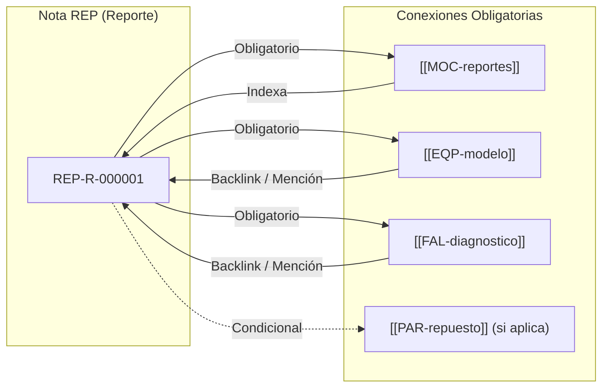

# Reglas de Nomenclatura, Enlaces Internos y Citas de Respaldo (MATRIX)

---
version: 1.0.0
fecha: 2026-11-20
estado: aprobado
autor: Arquitecto de Información y Base de Conocimiento
---

Este documento establece las directrices normativas obligatorias para la generación de archivos, enlaces hipertextuales y citas probatorias dentro de la base de conocimiento **MATRIX**. Tanto operadores humanos como modelos LLM (Claude, DeepSeek) deben apegarse estrictamente a estas reglas.

---

## 1. Nomenclatura Estricta de Archivos

### 1.1. Principios Generales
1. **Convención Kebab-Case con Prefijo en Mayúsculas**: La estructura del nombre es `<PREFIJO>-<slug-en-kebab-case>.md`.
2. **Juego de Caracteres Restringido**: Exclusivamente caracteres alfanuméricos ASCII en minúsculas (`a-z`, `0-9`), guiones simples (`-`) y el punto final de extensión (`.md`).
3. **Prohibiciones Absolutas**:
   - Prohibido el uso de espacios en blanco (usar guiones `-`).
   - Prohibido el uso de vocales con acento, tildes, diéresis o `ñ` (normalizar `a`, `e`, `i`, `o`, `u`, `n`).
   - Prohibido el uso de caracteres especiales del sistema operativo (`/`, `\`, `:`, `*`, `?`, `"`, `<`, `>`, `|`, `;`, `#`, `%`, `&`).
   - Prohibido el uso de mayúsculas en el cuerpo del slug (solo se permiten en el prefijo estandarizado).

### 1.2. Prefijos Estandarizados por Tipo de Nota

| Prefijo | Tipo de Entidad / Nota | Directorio Destino | Ejemplo de Archivo |
| :--- | :--- | :--- | :--- |
| **`REP-`** | Reporte Técnico Individual | `wiki/reportes/` | `REP-R-000001.md` |
| **`EQP-`** | Modelo o Familia de Equipo | `wiki/equipos/` | `EQP-bomba-mx-200.md` |
| **`FAL-`** | Falla, Síntoma o Diagnóstico | `wiki/fallas/` | `FAL-sobrecalentamiento-motor.md` |
| **`PAR-`** | Repuesto, Pieza o Consumible | `wiki/repuestos/` | `PAR-filtro-sintetico-fs-01.md` |
| **`MOC-`** | Mapa de Contenido / Índice | `wiki/indices/` | `MOC-fallas.md` |
| **`RES-`** | Resumen Ejecutivo / Informe | `wiki/resumenes/` | `RES-2026-q1-flota.md` |

### 1.3. Reglas Específicas para Reportes (`REP-`)
- El código numérico debe conservar el identificador de reporte canonizado en T01, rellenado a 6 dígitos:
  - Formato: `REP-R-XXXXXX.md` (ejemplo: `REP-R-000042.md`).
  - Nunca utilizar el nombre de fantasía del cliente en el nombre de archivo del reporte.

### 1.4. Reglas para Códigos Anonimizados en Contenidos
Para preservar la estricta privacidad requerida por el proyecto:
- **Clientes**: Formato `CLI-XXXX` (ejemplo: `CLI-0012`).
- **Técnicos**: Formato `TEC-XX` (ejemplo: `TEC-03`).
- **Números de Serie**: Formato `SERIE-XXXX` o `SERIE-SINT-XXXX`.
- **Teléfonos, Direcciones y Correos**: Reemplazados por sus valores anonimizados de la tabla de equivalencias (`datos_privados/tabla_codigos.csv`).

---

## 2. Enlaces Internos (`[[wikilinks]]`) y Topología del Grafo

Para garantizar que el grafo de Obsidian sea coherente, navegable y carezca de islas desconectadas, se aplican las siguientes reglas de conectividad:

### 2.1. Sintaxis de Enlace y Aliasing
- **Sintaxis Estándar**: Se utiliza la notación de doble corchete `[[nombre-del-archivo]]`.
- **Uso Obligatorio de Aliases Legibles**: En el cuerpo de la redacción, siempre se debe emplear un alias textual que favorezca la lectura natural:
  - ✅ Correcto: `El equipo inspeccionado fue una [[EQP-bomba-mx-200|Bomba MX-200]], la cual presentó [[FAL-fuga-sello-mecanico|fuga en el sello mecánico]].`
  - ❌ Incorrecto: `El equipo inspeccionado fue EQP-bomba-mx-200.`
- **Enlaces a Secciones Específicas**: Cuando se requiera dirigir a un punto técnico exacto:
  - Formato: `[[EQP-bomba-mx-200#2. Síntomas y Fallas Recurrentes|Fallas comunes de la Bomba MX-200]]`.

### 2.2. Regla Anti-Huérfanas (Obligatoriedad de Conexión)
Ninguna nota en la wiki puede tener cero enlaces entrantes (*in-links*) o cero enlaces salientes (*out-links*). Se define la siguiente matriz de enlaces obligatorios:



1. **Cada Nota de Reporte (`REP-`) debe enlazar obligatoriamente a**:
   - La nota de su equipo intervenido (`[[EQP-...]]`).
   - La nota de su diagnóstico o falla catalogada (`[[FAL-...]]`).
   - Las notas de los repuestos consumidos (`[[PAR-...]]`), si hubo cambio de partes.
   - El índice de reportes (`[[MOC-reportes]]`).
2. **Cada Nota de Entidad (`EQP-` / `FAL-`) debe**:
   - Enlazar a su respectivo MOC temático (`[[MOC-equipos]]` o `[[MOC-fallas]]`).
   - Contener al menos una mención o tabla de reportes históricos de respaldo (`[[REP-...]]`).
3. **Cada MOC (`MOC-`) debe**:
   - Enlazar al MOC General (`[[MOC-indice-general]]`).
   - Agrupar los enlaces activos a todas las entidades de su dominio.

---

## 3. Citas de Respaldo y Trazabilidad Antialucinación

Para garantizar que los LLMs en esquemas RAG generen respuestas estrictamente apegadas a la realidad fáctica y auditable:

### 3.1. Niveles de Citas Obligatorias
Cada dato fáctico (síntomas, diagnósticos, causa raíz, procedimientos ejecutados, repuestos y dictámenes finales) debe respaldarse con al menos una de las dos modalidades de cita:

#### Modalidad A: Notas al Pie Estructuradas (Footnotes)
Se ubica una referencia numérica o mnemónica junto a la afirmación y la definición de la cita al pie de la nota:
- **En el texto**: `Se procedió al cambio preventivo del rodamiento cónico delantero[^REP-R-000042-PROC].`
- **Al pie de página**:
  ```markdown
  [^REP-R-000042-PROC]: Reporte fuente [[REP-R-000042]], sección 'Procedimiento' (archivo limpio `limpio/R-000042.md`).
  ```

#### Modalidad B: Citas Directas en Bloques de Cita (Callouts / Blockquotes)
Cuando se transcriban descripciones técnicas literales del reporte original:
```markdown
> "Se constató juego axial excesivo en el eje principal de 1.2 mm, superando la tolerancia de catálogo."
> — [[REP-R-000042]], campo: *Revisión inicial*.
```

### 3.2. Sección Obligatoria `Trazabilidad y Fuentes`
Toda nota de reporte, entidad o resumen debe culminar con un encabezado de segundo nivel denominado:
```markdown
## Trazabilidad y Fuentes
```
En esta sección se listan:
- El archivo de origen exacto en `limpio/` (ej. `limpio/R-000042.md`).
- El número de reporte canónico de RP-TECH.
- La confirmación de consistencia (sin pérdida de campos respecto a la exportación).
- La lista completa de notas al pie referenciadas.

---

## 4. Ejemplos Comparativos (Correcto vs. Incorrecto)

### Ejemplo 1: Nombres de archivo
- ❌ `wiki/reportes/Reporte de Juan Pérez Bomba 1.md` (espacios, mayúsculas, datos PII, sin prefijo formal).
- ❌ `wiki/equipos/Bomba_MX-200.md` (guiones bajos, mayúsculas).
- ✅ `wiki/reportes/REP-R-000001.md` (estándar kebab-case con prefijo).
- ✅ `wiki/equipos/EQP-bomba-mx-200.md` (estándar canónico).

### Ejemplo 2: Enlaces internos
- ❌ `En este reporte reparamos el equipo Bomba MX-200.` (texto plano sin enlace, nodo desconectado).
- ❌ `Reparado según [[EQP-bomba-mx-200]].` (sin alias, lectura no fluida).
- ✅ `Se completó el mantenimiento de la [[EQP-bomba-mx-200|Bomba MX-200]] corrigiendo la [[FAL-fuga-sello-mecanico|fuga en el sello mecánico]].`

### Ejemplo 3: Citas en RAG
- ❌ `El técnico cambió los sellos porque suelen fallar cada 6 meses.` (alucinación / suposición sin fuente).
- ✅ `Se reemplazó el sello mecánico debido a desgaste prematuro por presencia de partículas[^REP-R-000001-PROC].`

---
*Fin de especificación de normas y convenciones.*
