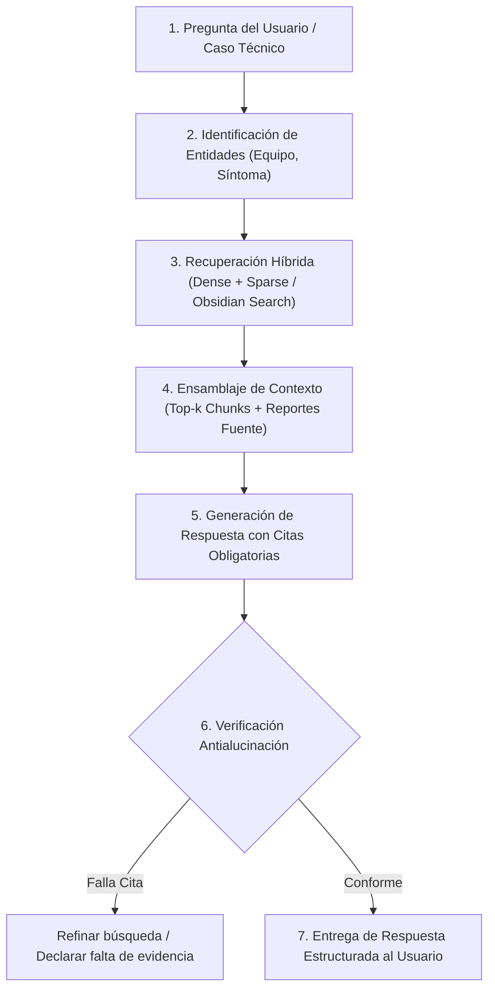

# SOP-02: Procedimiento Operativo Estándar de Consulta y Recuperación (RAG)

---
codigo: SOP-MTX-02
version: 1.0.0
fecha: 2026-11-20
estado: aprobado
proposito: Establecer el flujo de búsqueda, contextualización y generación de respuestas técnicas para operadores y sistemas RAG.
modelos_objetivo: Claude 3.5 Sonnet, DeepSeek V3, RAG Pipeline
---

## 1. Objetivo y Alcance
Este procedimiento rige el modo en que humanos o sistemas de Inteligencia Artificial consultan la base de conocimiento **MATRIX**. Establece cómo recuperar el contexto adecuado, responder interrogantes de diagnóstico técnico o análisis de flota, y citar con precisión forense las notas y reportes de respaldo para erradicar cualquier alucinación.

---

## 2. Flujo Metodológico de Consulta RAG



---

## 3. Estrategia de Recuperación de Contexto (Retrieval)

Al realizar una consulta técnica, el sistema o agente debe seguir un orden de recuperación en cascada:

1. **Paso 1: Identificación de Entidad Primaria**:
   - Localizar la ficha del equipo en `wiki/equipos/EQP-<modelo>.md`.
   - Recuperar especificaciones, síntomas típicos y piezas críticas.
2. **Paso 2: Localización de Síntomas y Diagnósticos**:
   - Localizar la nota de falla en `wiki/fallas/FAL-<sintoma>.md`.
   - Extraer el árbol de decisión y las causas raíces validadas.
3. **Paso 3: Recuperación de Casos Concretos (Reportes de Campo)**:
   - Recuperar los reportes vinculados `wiki/reportes/REP-R-XXXXXX.md` que coincidan con la combinación Equipo + Síntoma.
   - Extraer los procedimientos específicos y los repuestos efectivamente empleados.

---

## 4. Política Estricta de Respuesta Antialucinación (Ground Truth Policy)

Todo agente o analista que genere respuestas asistido por MATRIX debe respetar las siguientes directivas:

1. **Principio de Certeza Respaldada**: No se admiten deducciones presentadas como hechos históricos si no están sustentadas por al menos un reporte de servicio formal (`[[REP-R-XXXXXX]]`).
2. **Reconocimiento de Lagunas de Información**: Si la base de conocimiento no cuenta con intervenciones previas sobre un equipo o síntoma, la respuesta debe indicar expresamente:
   > *"No se registran antecedentes técnicos documentados en MATRIX para el equipo X con la falla Y. Las recomendaciones a continuación se basan en buenas prácticas generales de ingeniería y no en reportes históricos validados de GO Service."*
3. **Cita Ineludible**: Cada diagnóstico recomendado o tiempo de respuesta citado debe llevar su hipervínculo interno `[[REP-R-XXXXXX]]` o nota de origen.

---

## 5. Estructura Estándar de la Respuesta Técnica

Las respuestas generadas para técnicos o supervisores deben seguir esta estructura:

```markdown
### 1. Diagnóstico Probable
[Explicación concisa de la causa raíz más probable basada en el historial]

### 2. Procedimiento de Solución Recomendado (Paso a Paso)
1. **Paso 1**: [Acción técnica específica comprobada en campo]
2. **Paso 2**: [Punto de medición o calibración]
3. **Paso 3**: [Prueba de conformidad operativa]

### 3. Repuestos y Materiales Necesarios
- [[PAR-slug|Nombre de la Pieza]] (Referenciado en intervenciones previas)

### 4. Evidencia Documental y Trazabilidad (Reportes Fuente)
- **Caso de referencia 1**: [[REP-R-000042]] — Intervención en modelo Bomba MX-200 donde se resolvió la misma avería mediante ajuste del eje.
- **Caso de referencia 2**: [[REP-R-000108]] — Mismo síntoma corregido mediante cambio de sello.
```

---

## 6. Prompt de Sistema Estandarizado para Consultas RAG

Cuando se integre un LLM (Claude, DeepSeek) con el motor RAG de la wiki:

```markdown
Eres el Asistente Técnico Especializado de GO Service LATAM, conectado a la base de conocimiento MATRIX.

TUS INSTRUCCIONES OPERATIVAS:
1. Responde a la consulta técnica del usuario ÚNICAMENTE utilizando los fragmentos de contexto provistos a continuación (procedentes de wiki/reportes, wiki/equipos y wiki/fallas).
2. Para cada afirmación técnica, procedimiento correctivo o recomendación de repuesto, DEBES citar la nota o reporte de respaldo utilizando la sintaxis de enlace [[REP-R-XXXXXX]] o [[EQP-XXXXXX]].
3. Si la información provista es insuficiente para dar una respuesta certera, indícalo claramente sin inventar procedimientos ni números de parte.
4. No menciones nombres de personas o empresas confidenciales; refiérete siempre a los códigos anonimizados CLI-XXXX o TEC-XX.

CONTEXTO RECUPERADO DE LA WIKI:
{context}

PREGUNTA DEL USUARIO:
{query}
```

---
*Fin del Procedimiento Operativo Estándar de Consulta.*
