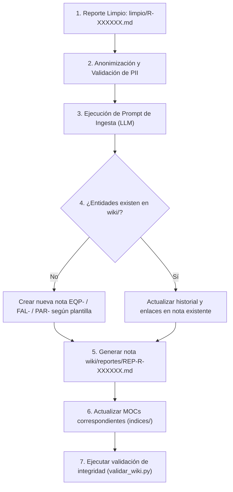

# SOP-01: Procedimiento Operativo Estándar de Ingesta (LLM / RAG)

---
codigo: SOP-MTX-01
version: 1.0.0
fecha: 2026-11-20
estado: aprobado
proposito: Guiar la transformación automatizada o semi-automatizada de reportes limpios a notas enriquecidas de la wiki.
modelos_objetivo: Claude 3.5 Sonnet, DeepSeek V3, GPT-4o
---

## 1. Objetivo y Alcance
Este procedimiento define el flujo sistemático para tomar los reportes técnicos limpios ubicados en `limpio/` (generados por `scripts/limpieza.py`), extraer sus entidades y hechos técnicos mediante un LLM, generar las notas Markdown correspondientes en `wiki/reportes/`, actualizar o crear las entidades vinculadas en `wiki/equipos/`, `wiki/fallas/` y `wiki/repuestos/`, y sincronizar los Mapas de Contenido (`wiki/indices/`).

---

## 2. Diagrama del Flujo de Ingesta



---

## 3. Requisitos Previos y Entradas
1. Archivo fuente en `limpio/R-XXXXXX.md` con campos no vacíos:
   - Número de reporte
   - Fecha de servicio
   - Equipo (modelo)
   - Motivo y Revisión inicial
   - Procedimiento ejecutado
   - Conclusión y Recomendaciones
2. Tablas de códigos de anonimización cargadas (en caso de procesar reportes con nombres de personas o empresas).
3. Acceso a las plantillas maestras en `wiki/_templates/`.

---

## 4. Instrucción Paso a Paso para el Agente / LLM

### Paso 1: Lectura y Extracción de Parámetros
El modelo debe leer el archivo limpio y clasificar los siguientes campos sin modificar el sentido técnico original:
- `slug_equipo`: nombre normalizado en kebab-case del modelo del equipo (ej. `bomba-mx-200`).
- `slug_falla`: diagnóstico o síntoma estandarizado en kebab-case (ej. `sobrecalentamiento-motor`, `fuga-sello-mecanico`).
- `partes_usadas`: lista de repuestos mencionados con su slug correspondiente.
- `severidad`: evaluación técnica fundada (Baja, Media, Alta, Crítica).
- `estado_final`: Operativo, En Observación, o Inoperativo.

### Paso 2: Generación de la Nota de Reporte (`REP-R-XXXXXX.md`)
1. Abrir la plantilla `wiki/_templates/tpl-reporte-individual.md`.
2. Completar todos los campos del Frontmatter YAML con valores válidos (sin placeholders vacíos).
3. Redactar el Resumen Ejecutivo (sección 1) de máximo 3 líneas sintetizando la atención.
4. Conservar citas textuales literales de los campos originales `Motivo`, `Revisión inicial`, `Procedimiento` y `Conclusión`.
5. Insertar las notas al pie de respaldo `[^REP-R-XXXXXX-MOT]`, etc., asociando cada dato a su campo original.
6. Guardar el archivo en `wiki/reportes/REP-R-XXXXXX.md`.

### Paso 3: Sincronización de Entidades (`equipos/`, `fallas/`, `repuestos/`)
Para cada entidad involucrada:
- **Si el archivo `wiki/equipos/EQP-<slug>.md` no existe**:
  - Crearlo usando `wiki/_templates/tpl-entidad-equipo.md`.
  - Vincularlo al reporte recién procesado y al índice `[[MOC-equipos]]`.
- **Si ya existe**:
  - Abrir la nota y agregar una nueva fila en la sección de historial/reportes vinculados:
    `- [[REP-R-XXXXXX|Reporte XXXXXX]] (AAAA-MM-DD): Síntoma atendido.`
  - Incrementar el contador `total_interventions` en el YAML.
- Repetir la misma lógica con la entidad de falla `wiki/fallas/FAL-<slug>.md`.

### Paso 4: Actualización de Mapas de Contenido (`indices/`)
1. Comprobar que el reporte esté enlazado en `wiki/indices/MOC-reportes.md`.
2. Comprobar que los nuevos equipos o fallas figuren en `wiki/indices/MOC-equipos.md` y `wiki/indices/MOC-fallas.md`.

---

## 5. Plantilla de Prompt para Ingesta Automatizada con LLM

Cuando se invoque a Claude o DeepSeek para la ingesta de un reporte, se debe suministrar el siguiente prompt del sistema:

```markdown
Eres un Arquitecto de Información Técnica especializado en Obsidian y RAG para el proyecto MATRIX.
Tu tarea es ingerir el siguiente reporte limpio y convertirlo en una nota de reporte estructurada según la plantilla oficial.

REGLAS ESTRICTAS:
1. No inventes procedimientos ni repuestos no presentes en el texto original.
2. Si un dato no figura en el origen, márcalo como "No especificado en reporte original".
3. Utiliza estrictamente la convención de enlaces [[EQP-slug|Nombre]], [[FAL-slug|Falla]] y [[PAR-slug|Repuesto]].
4. Anonimiza cualquier nombre propio o empresa utilizando los códigos CLI-XXXX o TEC-XX.
5. Incluye obligatoriamente la sección final de "Trazabilidad y Fuentes" con notas al pie para cada afirmación técnica.

PLANTILLA A UTILIZAR:
[Contenido de wiki/_templates/tpl-reporte-individual.md]

REPORTE LIMPIO DE ENTRADA:
[Pegar contenido de limpio/R-XXXXXX.md]

SALIDA REQUERIDA:
Devuelve exclusivamente el contenido final en formato Markdown listo para ser guardado en wiki/reportes/REP-R-XXXXXX.md.
```

---

## 6. Criterios de Aceptación de la Ingesta
- [ ] El archivo generado cumple el nombre `REP-R-XXXXXX.md` sin caracteres especiales.
- [ ] El frontmatter YAML es sintácticamente válido y contiene los campos obligatorios.
- [ ] No existen enlaces rotos a entidades inexistentes.
- [ ] No se filtró información confidencial (PII).
- [ ] Se ejecutó el script de verificación sin errores.
