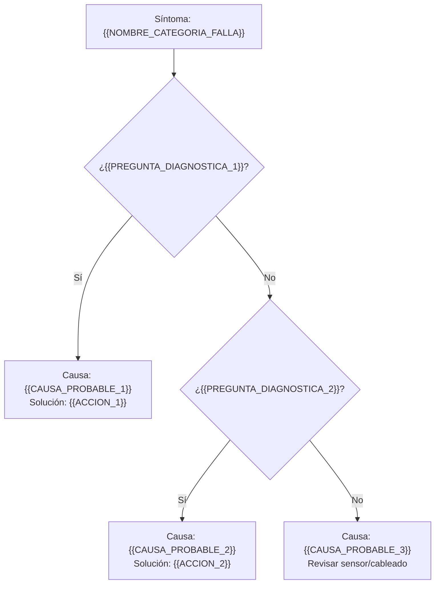

# ⚠️ Falla / Síntoma: {{NOMBRE_CATEGORIA_FALLA}}

> [!WARNING] Alerta de Diagnóstico
> - **Sistema Afectado**: `{{SISTEMA_AFECTADO}}`
> - **Severidad Típica**: `{{SEVERIDAD_TIPICA}}`
> - **Índice Superior**: [[MOC-fallas|Catálogo Taxonómico de Fallas]]
> - **Tiempo promedio de resolución**: `{{TIEMPO_PROMEDIO_RESOLUCION}}`

---

## 1. Descripción del Síntoma y Manifestación
{{DESCRIPCION_DETALLADA_SINTOMA}}
<!-- Cómo reporta el cliente la falla y qué se observa en la inspección física inicial. -->

---

## 2. Árbol de Decisión y Diagnóstico Diferencial



---

## 3. Matriz de Causas Raíz y Soluciones Validadas en Campo

| Causa Raíz Identificada | Procedimiento de Corrección Comprobado | Repuestos Habituales | Fuente de Validación |
| :--- | :--- | :--- | :--- |
| {{CAUSA_RAIZ_1}} | {{ACCION_CORRECTIVA_1}} | [[PAR-{{SLUG_REPUESTO_1}}\|{{NOMBRE_REPUESTO_1}}]] | [[REP-{{ID_REPORTE_1}}]] |
| {{CAUSA_RAIZ_2}} | {{ACCION_CORRECTIVA_2}} | [[PAR-{{SLUG_REPUESTO_2}}\|{{NOMBRE_REPUESTO_2}}]] | [[REP-{{ID_REPORTE_2}}]] |

---

## 4. Equipos y Modelos Más Afectados
Lista de equipos donde se ha presentado con mayor incidencia este tipo de falla:
- [[EQP-{{SLUG_EQUIPO_1}}|{{NOMBRE_EQUIPO_1}}]] (`{{CANTIDAD_CASOS_1}}` casos)
- [[EQP-{{SLUG_EQUIPO_2}}|{{NOMBRE_EQUIPO_2}}]] (`{{CANTIDAD_CASOS_2}}` casos)

---

## 5. Medidas de Prevención y Mantenimiento Proactivo
Pautas para evitar la recurrencia de este síntoma en intervenciones programadas:
- [ ] {{MEDIDA_PREVENTIVA_1}}
- [ ] {{MEDIDA_PREVENTIVA_2}}
- [ ] {{MEDIDA_PREVENTIVA_3}}

---

## 6. Historial de Reportes con este Diagnóstico

```dataview
TABLE service_date AS "Fecha", equipment AS "Equipo", technician_id AS "Técnico", status AS "Estado"
FROM "wiki/reportes"
WHERE contains(failure_category, "{{NOMBRE_CATEGORIA_FALLA}}")
SORT service_date DESC
```

### Casos de Referencia Documentados
- [[REP-{{ID_REPORTE_1}}|{{ID_REPORTE_1}}]] en [[EQP-{{SLUG_EQUIPO_1}}]]: {{RESUMEN_CASO_1}} [^REP-{{ID_REPORTE_1}}]
- [[REP-{{ID_REPORTE_2}}|{{ID_REPORTE_2}}]] en [[EQP-{{SLUG_EQUIPO_2}}]]: {{RESUMEN_CASO_2}} [^REP-{{ID_REPORTE_2}}]

---

## 7. Trazabilidad y Citas
[^REP-{{ID_REPORTE_1}}]: Intervención confirmada en `limpio/R-{{ID_REPORTE_1}}.md`, campo 'Diagnóstico/Conclusión'.
[^REP-{{ID_REPORTE_2}}]: Intervención confirmada en `limpio/R-{{ID_REPORTE_2}}.md`, campo 'Diagnóstico/Conclusión'.
