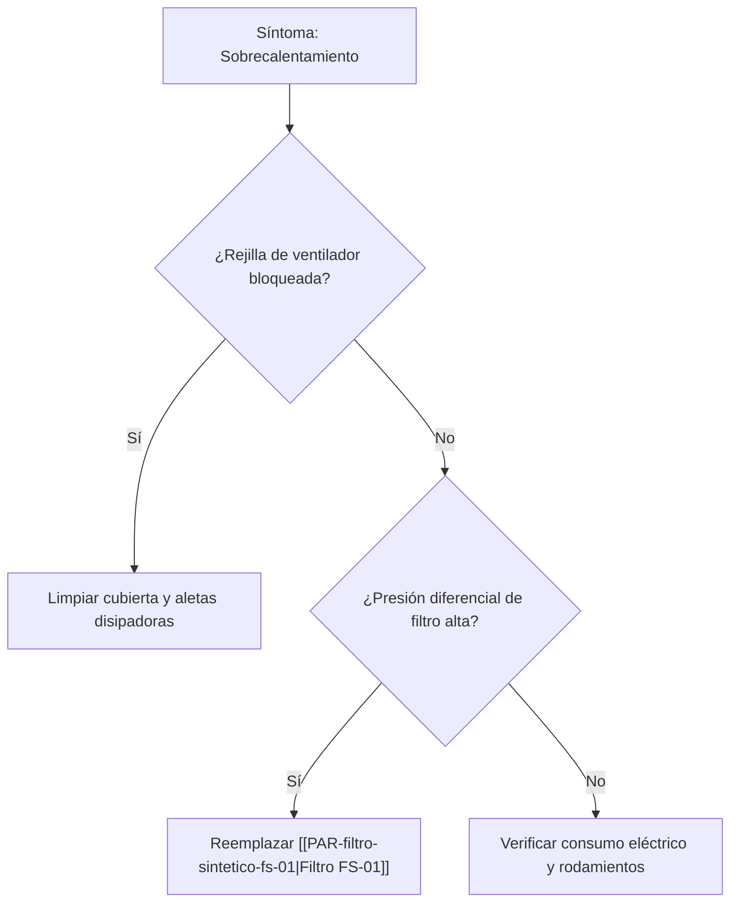

# ⚠️ Falla / Síntoma: Sobrecalentamiento de Motor

> [!WARNING] Alerta de Diagnóstico
> - **Sistema Afectado**: `Mecánico / Eléctrico`
> - **Severidad Típica**: `Media`
> - **Índice Superior**: [[MOC-fallas|Catálogo Taxonómico de Fallas]]
> - **Tiempo promedio de resolución**: `1.5 horas`

---

## 1. Descripción del Síntoma y Manifestación
El cliente reporta elevación excesiva de temperatura en la superficie del estator o paradas térmicas intempestivas mediante relé de protección.

---

## 2. Árbol de Decisión y Diagnóstico Diferencial

---

## 3. Matriz de Causas Raíz y Soluciones Validadas en Campo

| Causa Raíz Identificada | Procedimiento de Corrección Comprobado | Repuestos Habituales | Fuente de Validación |
| :--- | :--- | :--- | :--- |
| Saturación de flujo en succión | Limpieza de línea y cambio de elemento | [[PAR-filtro-sintetico-fs-01\|Filtro sintético FS-01]] | [[REP-R-000001]] |

---

## 4. Equipos y Modelos Más Afectados
- [[EQP-bomba-mx-200|Bomba MX-200]] (1 caso registrado)

---

## 5. Casos de Referencia Documentados
- [[REP-R-000001|Reporte R-000001]] en [[EQP-bomba-mx-200]]: Reemplazo de filtro por elevación térmica. [^REP-R-000001]

---

## 6. Trazabilidad y Citas
[^REP-R-000001]: Intervención confirmada en `limpio/R-000001.md`, campos 'Motivo' y 'Procedimiento'.
