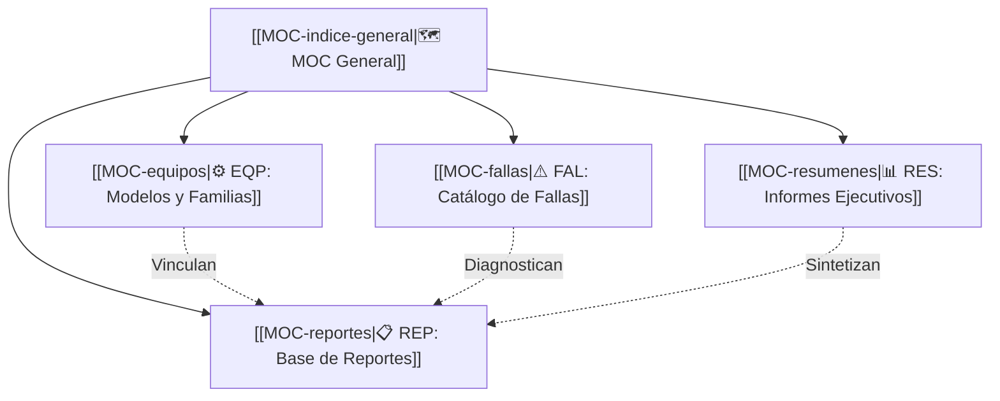

# 🗺️ Mapa de Contenido Maestro (MOC Principal)

Bienvenido al punto de entrada central de la base de conocimiento técnica de **GO Service LATAM (MATRIX)**. Esta wiki ha sido estructurada a partir de reportes de servicio procesados, anonimizados y convertidos en conocimiento navegable y consultable para humanos y modelos de lenguaje (LLM / RAG).

---

## 📌 Navegación por Ejes Temáticos

### 1. Equipos y Familias Técnicas
Catálogo central de equipamiento atendido en campo, fichas técnicas, historial de servicios y piezas críticas:
- [[MOC-equipos|Índice Maestro de Equipos y Modelos]]
- *Plantilla de referencia*: `wiki/_templates/tpl-entidad-equipo.md`

### 2. Catálogo de Diagnósticos y Fallas
Base taxonómica de síntomas, causas raíces, procedimientos de solución probados y árboles de resolución de problemas:
- [[MOC-fallas|Índice Taxonómico de Fallas y Síntomas]]
- *Plantilla de referencia*: `wiki/_templates/tpl-entidad-falla.md`

### 3. Registro Histórico de Reportes Técnicos
Repositorio individualizado de intervenciones de servicio técnico con trazabilidad completa al dato de origen:
- [[MOC-reportes|Índice Cronológico y Clasificado de Reportes]]
- *Plantilla de referencia*: `wiki/_templates/tpl-reporte-individual.md`

### 4. Resúmenes Ejecutivos y Métricas de Flota
Análisis periódicos de confiabilidad, consumo de repuestos e indicadores operativos:
- [[MOC-resumenes|Índice de Resúmenes Ejecutivos y Tendencias]]
- *Plantilla de referencia*: `wiki/_templates/tpl-resumen-ejecutivo.md`

---

## 🛠️ Normas Operativas y Estándares
Para mantener la integridad del grafo de conocimiento y la precisión de consultas RAG:
- 📖 [Esquema General de la Wiki](file:///docs/esquema/ESQUEMA_GENERAL.md)
- 🏷️ [Reglas de Nomenclatura, Enlaces y Citas](file:///docs/esquema/REGLAS_NOMENCLATURA_ENLACES_CITAS.md)
- 📥 [SOP: Procedimiento de Ingesta con LLMs](file:///docs/esquema/SOP_INGESTA.md)
- 🔍 [SOP: Procedimiento de Consulta RAG](file:///docs/esquema/SOP_CONSULTA.md)
- 🧪 [SOP: Procedimiento de Revisión y Auditoría](file:///docs/esquema/SOP_REVISION.md)

---
*MATRIX Knowledge Base — Estructura generada para Obsidian & RAG Ingestion Pipeline.*
